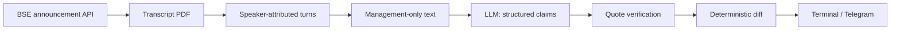

<div align="center">

# Subtext

**Don't read the filing. Read what changed in it.**

A disclosure intelligence engine for Indian equities. Subtext compares what company management says, quarter over quarter, and surfaces the shifts that matter, each backed by a verified quote from the source filing.

[](https://github.com/Shresth8x/subtext/actions/workflows/ci.yml)


[Quick start](#quick-start) · [Example output](#example-output) · [How it works](#how-it-works) · [Roadmap](#roadmap) · [Docs](docs/README.md)

</div>

---

## Why Subtext

Every listed company in India must publish earnings call transcripts, annual reports, shareholding patterns, insider trades and rating actions. The information is public, but it is buried in hundreds of PDFs, and the real signal is rarely in any single document. It is in the **change**: a CEO who sounded confident on guidance last quarter and sounds cautious now, a risk raised for the first time, a topic that quietly stopped being discussed.

Subtext reads the filings, normalises them into structured claims, and tells you what moved, with the evidence attached.

> **We don't tell you what to buy. We tell you what changed.**

## Features

- **Live data, no scraping tricks.** Pulls earnings call transcripts straight from BSE's public announcement API, including banks that file under "Analyst / Investor Meet".
- **Speaker-aware parsing.** Separates management from analysts and moderators, so analyst wording never contaminates the stance reading. Handles four transcript formats found in real filings.
- **Claims diff, not text diff.** Each quarter becomes a structured record (topic, stance, verbatim quote). Records are compared, so reworded sentences don't create noise.
- **Deterministic diff engine.** No LLM in the comparison step. The model normalises, arithmetic decides what changed, so the same inputs always give the same output.
- **Quotes verified in code.** Every cited sentence must appear verbatim in the source transcript. Anything that doesn't is dropped, not flagged.
- **Bring any model.** Works with free tiers (Gemini, Groq, OpenRouter, GitHub Models) or Anthropic. Provider is picked from whichever key you set.
- **Telegram delivery.** Send a finished diff to a Telegram chat with `--telegram`.
- **Coverage you can measure.** One command runs the pipeline across the whole Nifty 100 and reports exactly where and why it fails, without spending on inference.

## Example output

> Format preview using **synthetic data** for a fictional company. Real runs use live BSE filings.

```text
────────────────────────────────────────────────────────────────────
  CONCALL DIFF — ExampleCo Ltd (synthetic data)
  Q1 FY27 vs Q4 FY26
────────────────────────────────────────────────────────────────────

  Management softened on guidance, margins; raised risk for the
  first time; stopped discussing hiring.

  LANGUAGE SOFTENED
   • GUIDANCE   confident → cautious  (-3)
     Q4 FY26:
     │ "We are confident of delivering double-digit growth this
     │ year."
     Q1 FY27:
     │ "We are watching the demand environment closely before
     │ updating guidance."

   • MARGINS   positive → neutral  (-1)
     Q4 FY26:
     │ "Margins should expand through the year."
     Q1 FY27:
     │ "Margins will be broadly in line with last quarter."

  RAISED FOR THE FIRST TIME
   • RISK  [cautious]
     │ "Client budget uncertainty is something we are monitoring."

  STOPPED DISCUSSING
   • HIRING  — raised in Q4 FY26, absent in Q1 FY27
     │ "We will continue to add talent aggressively."

  TONE  4/10 → 3/10  ↓ (-1)

────────────────────────────────────────────────────────────────────
  Research Only — Not Investment Advice
────────────────────────────────────────────────────────────────────
```

## Quick start

**Requirements:** Python 3.10+. An LLM key is only needed for `extract` and `diff`; a free Gemini key works.

```bash
git clone https://github.com/Shresth8x/subtext.git
cd subtext
pip install -r requirements.txt
cp .env.example .env     # add ONE provider key, e.g. GEMINI_API_KEY (free)
```

```bash
python -m subtext transcripts INFY        # list earnings-call transcripts on BSE
python -m subtext parse INFY              # speaker attribution (no API key needed)
python -m subtext extract INFY            # structured management claims
python -m subtext diff INFY               # quarter-over-quarter diff
python -m subtext diff INFY --telegram    # also deliver it to Telegram
python -m subtext batch --universe 100    # coverage across the Nifty 100 (no API key)
python -m subtext providers               # show which LLM backend is configured
```

Run the tests (16 tests, no network needed):

```bash
pip install pytest
python -m pytest tests/ -v
```

<details>
<summary><b>Choosing an LLM provider</b></summary>

Set one key in `.env`. The first provider with a key present is used. Free options come first.

| Provider | Env variable | Cost |
|---|---|---|
| Google Gemini | `GEMINI_API_KEY` | Free tier |
| Groq | `GROQ_API_KEY` | Free tier |
| OpenRouter | `OPENROUTER_API_KEY` | Free models available |
| GitHub Models | `GITHUB_MODELS_TOKEN` | Free with a GitHub token |
| Anthropic | `ANTHROPIC_API_KEY` | Paid |

Force a provider with `SUBTEXT_PROVIDER` or override the model with `SUBTEXT_MODEL`.
</details>

<details>
<summary><b>Telegram setup</b></summary>

1. Create a bot with [@BotFather](https://t.me/BotFather) and copy the token.
2. Set `TELEGRAM_BOT_TOKEN` in `.env`.
3. Message your bot once, then run `python -m subtext telegram` to check the token and find your chat id.
4. Set `TELEGRAM_CHAT_ID` in `.env`.
</details>

## How it works



| Stage | Module | What it does |
|---|---|---|
| Ingest | `bse.py` | Finds and downloads transcripts from BSE, with on-disk caching |
| Parse | `transcript.py` | Turns PDFs into speaker-attributed turns and classifies management, analyst, journalist |
| Extract | `claims.py`, `providers.py` | Normalises each quarter into topic, stance and verbatim-quote records |
| Diff | `diffengine.py` | Compares two quarters, flags softening, hardening, new and dropped topics |
| Deliver | `render.py`, `telegram.py` | Renders to terminal or Telegram |
| Coverage | `batch.py`, `universe.py` | Runs ingest and parse across Nifty 50/100/200/500 and reports outcomes |

**Topics tracked:** guidance, margins, demand, capital allocation, capex, hiring, competition, risk.
**Stances:** confident, positive, neutral, cautious, negative.

## Measured coverage

Measured on the full Nifty 100 against live BSE data (`python -m subtext batch --universe 100`):

| Outcome | Companies | Meaning |
|---|---|---|
| Diffable | **61** | Two or more transcripts, parsed, roles separated |
| No speaker attribution | 15 | Filing is continuous prose, refused by design |
| Roles not separated | 12 | Parses, but management and analysts land together |
| No transcript filed | 8 | Nothing on BSE in the search window |
| Only one transcript | 4 | Nothing yet to compare against |

Verified end to end on INFY, TCS, HDFCBANK, ASIANPAINT, DMART and SUNPHARMA. Known gaps and the reasoning behind each design decision are in [`docs/prototype-status.md`](docs/prototype-status.md).

## Principles

- **Sources or silence.** Every claim carries its source quote. If data is missing, Subtext says so instead of guessing.
- **Evidence, not advice.** No buy/hold/sell verdicts and no conviction scores. Subtext reports changes and flags and lets the reader form a view.
- **Refuse rather than guess.** If a ticker resolves ambiguously or a transcript has no speaker labels, the pipeline stops instead of producing plausible but wrong output.
- **Read-only.** No order placement, no broker integration.
- **Auditable.** Deterministic comparison and verified quotes mean every output can be traced back to a filing.

## Roadmap

| Stage | Scope | Status |
|---|---|---|
| **v0** | Concall Diff engine, CLI, Telegram delivery, Nifty 100 coverage | ✅ Working |
| **v0.x** | Fix remaining parser gaps (RELIANCE, SUNPHARMA, TATAMOTORS), reach 80+/100 coverage | 🔨 Next |
| **v1** | Announcement feed, Morning Dispatch, governance tripwires (pledging, auditor exit, rating actions), watchlists | Planned |
| **v2** | Smart money: bulk/block deals, insider filings, delivery spikes, mutual fund changes. Management credibility ledger | Planned |
| **v3** | Entity graph: chain-reaction alerts, real peer sets, director interlocks | Planned |
| **v4** | Event pattern matching over backfilled history | Planned |

The full product thesis is in [`docs/product-definition.md`](docs/product-definition.md).

## Project structure

```text
subtext/
├── subtext/          # Core package: ingest, parse, extract, diff, deliver
├── tests/            # 16 tests covering diff arithmetic, quote verification, delivery
├── docs/             # Product definition, technical design, schema, status
├── .env.example      # Configuration template
└── requirements.txt
```

## Contributing

Issues and ideas are welcome. If you find a company whose transcript fails to parse, open an issue with the ticker. Those reports are the fastest way to improve coverage.

## Disclaimer

Subtext is a research tool. Nothing it produces is investment advice or a recommendation to buy or sell any security. Always verify against the original filings. Not affiliated with BSE, NSE or SEBI.

## License

[MIT](LICENSE) © 2026 Shresth

---

<div align="center">
Built by <a href="https://github.com/Shresth8x">Shresth</a>
</div>
